# dsh-theme-admech — 机械神教 · 铸炉圣殿（纯 A / v0.7.13）

> **状态：v0.7.13。macOS（DSH 0.2.1-rc.2）与 Windows 11 真机均完成渲染验收；v0.7.13 从背景图中删除了机械神甫。**
> Windows 适配细节见文末「Windows 适配（v0.7.0 · 实测）」，其中包含实测过的安装流程、失败模式与可复现的渲染审计脚本。
> 尚未安装到你的日常桌面 profile（桌面 profile 由 Electron 独占写入，需你在「插件」页点一次安装）。
> 图标标准 = 你提供的齿轮-骷髅：只改颜色、等比缩放，不重绘。

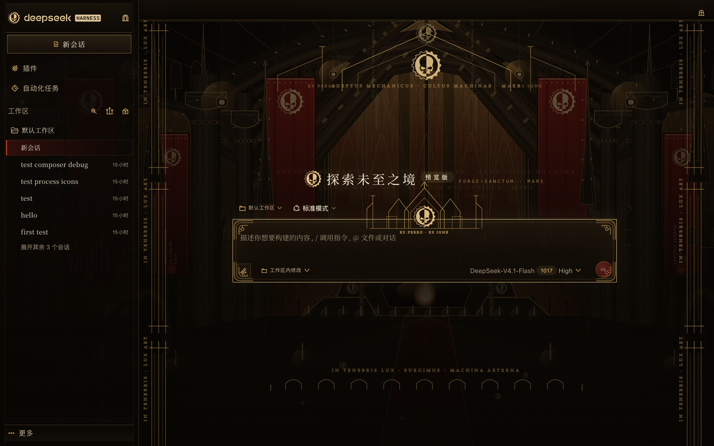

## v0.4 重点

### 1. 输入框：去掉大弧线，改成尖顶神殿 crest

- 原先的宽弧形顶饰已删除；改为**陡峭尖顶 + 双塔 + 尖拱窗 + 卷叶饰 + 你提供的齿轮-骷髅徽记**；
- 装饰主体上移，只让底部山花压在上边框；**不进入文字区域**，不遮挡 placeholder / 输入内容；
- 保留黄铜双线框、四角花窗、圆形火星红发送键，输入区保持清晰；
- 顶部小铭文 “EX FERRO · EX IGNE” 只在卡片上沿，不压正文。

### 2. 背景：面式尖拱 portal，替代纯弧线

- 中央改为**由直线段构成的尖拱大门**（faceted pointed arch）：多层 archivolt 石带、锯齿/菱形雕饰、尖顶山花（gable）、卷叶饰（crockets）、两侧尖塔与扶壁、侧柱、雕像龛；
- 门内保留彩窗，但不再用大圆形玫瑰窗，也不用单一圆滑曲线；
- 两侧加入尖拱 arcade / triforium 小拱 / 束柱；
- 旗帜与背景多处使用你提供的齿轮-骷髅，并加入复杂祷文：OMNISSIAH / DEUS MACHINA / EX FERRO / EX IGNE / IN TENEBRIS / LUX AETERNA / SURGE MACHINA / MARS INVICTA；
- 地面、柱身、山花、门楣都有祷文铭刻；烛光、锻炉、光柱、尘埃、苔藓、裂缝、锈迹强化“黑暗中辉煌、腐朽中不屈”。

### 3. 小鲸鱼 → 齿轮-骷髅

- hero 标题前的 DeepSeek 小鲸鱼已替换为你提供的齿轮-骷髅；
- 品牌标识、旗帜、对话框徽章、输入框 crest、插件卡片统一使用同一标准徽记。

### 4. 对话框 / 会话框

- 设置等模态框使用尖顶徽章 + 四角花窗 + 标题装饰线 + 黄铜双框；
- 会话区四周使用**尖顶式 conversation crest**（不再是纯弧），两侧束柱轨、底部 arcade 饰带与纵向祷文；
- 聊天内容保持可读，装饰都带 pointer-events: none。


## v0.4.2：关闭插件后图标恢复修复（v0.5.1 已改为更安全的方案）

**问题**：停用插件时，cleanup 只移除了主题 CSS 和根节点属性，没有恢复被替换的 SVG 图标（viewBox / fill / stroke / width / height / innerHTML），也没有恢复被替换成内联 SVG 的 img 元素；因此关闭插件后页面仍显示 Forge-Cathedral 图标，需要刷新才恢复。

**修复**：

- 最初方案：记录原始 attributes / innerHTML，cleanup 时恢复；该方案在 v0.5.1 因 React removeChild 冲突被移除；
- 现在不再改写 SVG 子节点，图标改用 CSS mask 绘制，关闭插件只需移除属性即可恢复；
- 对插件页里被替换的 img 元素记录父节点/兄弟节点，cleanup 时移除替代 SVG 并插回原 img；
- 清理所有 data-admech / data-admech-icon / data-admech-brand / data-admech-hero-mark / data-admech-placeholder 属性；
- 重新启用时重新记录并重新替换。

**验证**（真实 DSH 0.2.1-rc.2，隔离 profile）：

- 启用状态：28 个图标被替换；
- 连续停用两次后：svg[data-admech-icon] = 0，[data-admech-glyph] = 0，data-admech 属性 = 0；
- 品牌图标恢复为原生 DeepSeek 鲸鱼轮廓（viewBox 23.16 x 17.04），插件卡片恢复原生图标；
- 重新启用后：28 个图标再次替换，主题恢复；
- 停用状态截图：shots/disabled-native.png；
- 启用状态 layout_audit PASS：1440×900 + 390×844，报告 .layout-guard/runs/20261018-192646-l3en-audit/report.json。

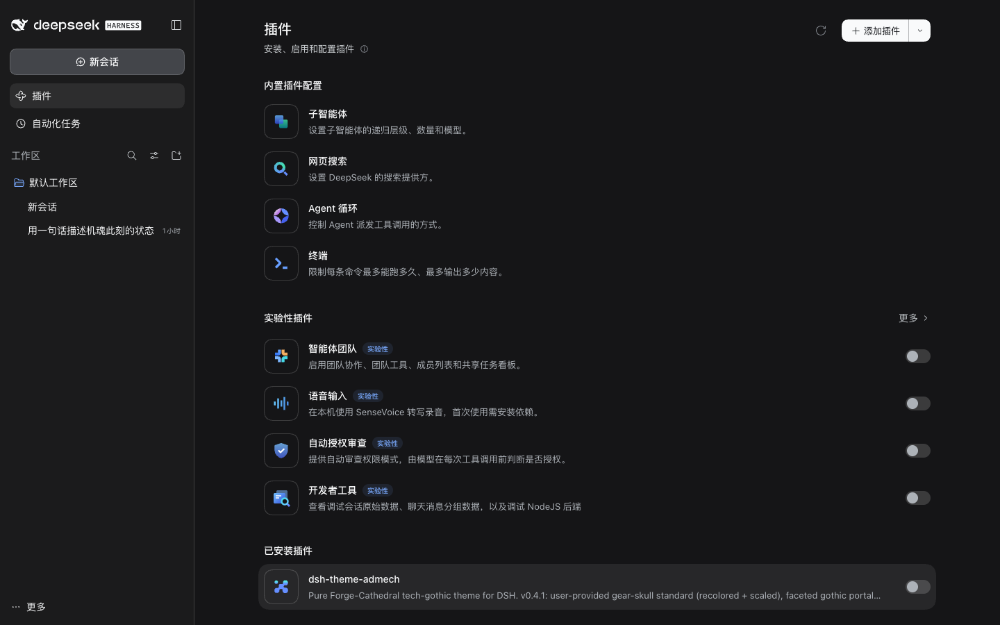


## v0.5.0：启动页 · 铸造圣殿点火序列（标题在 v0.5.3 改为“铸造圣殿”）

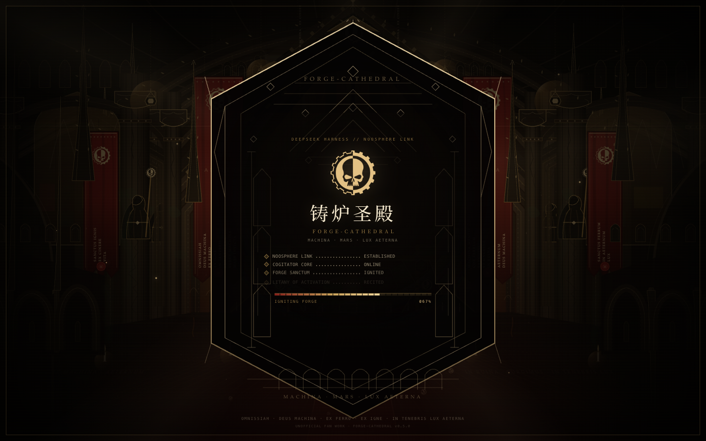

- 在 DSH 页面加载、主题插件激活后，显示全屏启动覆盖层；约 3 秒后自动淡出；
- 中央是尖拱/六边哥特框、侧龛、山花、底部 arcade、你提供的齿轮-骷髅、祷文铭刻；
- 逐行点火日志：NOOSPHERE LINK / COGITATOR CORE / FORGE SANCTUM / LITANY OF ACTIVATION；
- 黄铜进度轨 + 百分比、火星余烬、光柱、扫描线、轻微闪烁；
- 点击任意位置或按 Enter / Esc / Space 可跳过；
- 系统开启 prefers-reduced-motion 时自动缩短动画；
- 自动化截图 / layout audit 可通过 URL hash 跳过启动页：#admech-splash=0；
- 这是客户端启动覆盖层，不是 macOS/Windows 原生启动画面；不会缩短应用真实启动时间，只是在页面可用后播放约 3 秒的点火序列。

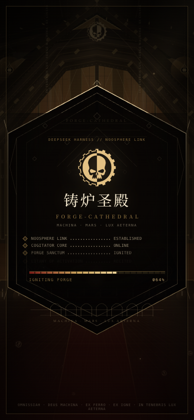

验证：

- 桌面 1440×900 / 移动 390×844 截图通过；
- 3 秒后自动移除，底层 UI 正常；
- 点击跳过验证通过；
- 跳过启动页后 layout_audit PASS：报告 .layout-guard/runs/20261018-193502-d7yl-audit/report.json；
- 浏览器控制台无错误；启动页不依赖 macOS 专用 API。


## v0.5.1：修复发送消息后输入框永久消失（React removeChild）

**现象**：发送一条消息后，composer / 输入框永久消失；新建会话、切换其他会话也没有输入框，刷新才恢复。

**根因**：

- 原图标替换会直接改写 React 管理的原生 SVG 的 viewBox / fill / stroke / innerHTML；
- 从 hero 输入区切换到 chat composer 时，React 尝试移除已被我们替换掉的 SVG 子节点；
- 控制台出现：

    NotFoundError: Failed to execute 'removeChild' on 'Node'
    slot entry crashed in 'conversation.composer.bar'

- composer.bar 插槽崩溃后，输入框被永久卸载。

**修复（v0.5.1）**：

- 不再修改 React 管理的 SVG 子节点、viewBox、fill、stroke、width、height；
- 保留原生 SVG 树，仅加 data-admech-icon 标记，用 CSS mask + background-color: currentColor 绘制 Forge-Cathedral 图形；
- 原生 SVG 子节点只用 CSS opacity: 0 隐藏，DOM 结构保持完整，React reconcile 安全；
- 不再把插件页的 img 节点替换成 SVG（避免同类 removeChild 风险）；
- 关闭插件时只移除 data-admech 属性和 mask style，原生图标立即恢复（v0.4.2 的图标回归能力保留）。

**验证**（真实 DSH 0.2.1-rc.2，隔离 profile）：

- 连续发送两次消息：composer 与输入框始终存在（cardCount=1 / inputCount=1）；
- 新建会话：输入框存在；
- 切换会话：输入框存在；
- 控制台无错误，无 removeChild；
- 停用插件：data-admech 属性 0，mask style 移除，原生鲸鱼/图标恢复；
- 重新启用：图标与主题恢复；
- 启用状态 layout_audit PASS：1440×900 + 390×844，报告 .layout-guard/runs/20261018-193923-32op-audit/report.json。

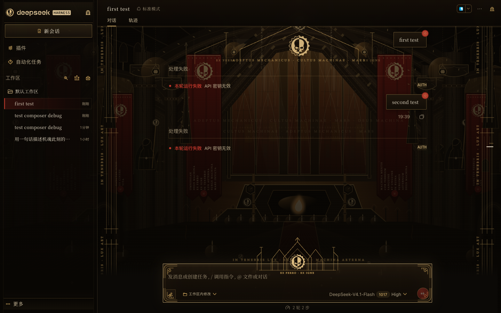


## v0.5.2：深度求索中 + 对话过程图标重设计

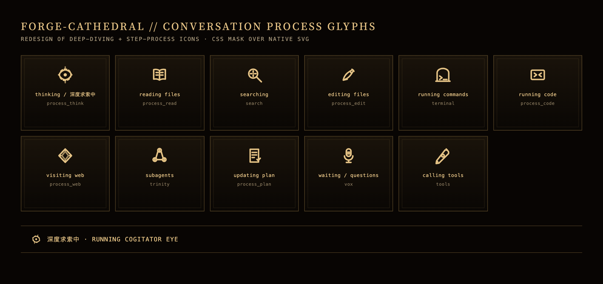

将 DeepSeek 的鲸鱼/内置过程图标替换为 Forge-Cathedral 原生图形：

- **深度求索中**：隐藏原生 APNG 鲸鱼，复用原生 SVG 作为 mask 宿主，显示缓慢旋转的**机魂之眼**（齿轮 + 眼），保留呼吸式辉光；
- **进行中状态**的文字改为衬线字体 + 黄铜色，并保留 shimmer；
- **对话过程步骤**按 DSH 的 data-process-activity 映射：

| DSH 状态 | 图标 |
|---|---|
| thinking / 正在分析请求 | process_think（机魂之眼） |
| read / readImage | process_read（圣典） |
| webFetch | process_web（罗盘） |
| search / webSearch | search（带十字准星的透镜） |
| edit / write | process_edit（羽毛笔） |
| commands | terminal（终端圣龛） |
| code | process_code（代码终端） |
| subagents | trinity（三机魂节点） |
| plan | process_plan（计划卷轴） |
| questions | vox（声讯） |
| tools | tools（工具） |

实现方式仍是 **CSS mask over untouched native SVG**：不替换 React 节点、不改写 SVG 子节点，因此不会重新引入 composer 的 removeChild 崩溃；关闭插件时只移除属性与 mask style，原生图标恢复。所有动画在系统开启减少动态效果时关闭。

验证：

- 按 data-process-activity 全覆盖检查：12 个状态均映射到对应图标；
- 合成 DOM 渲染检查（含 running 状态）通过，控制台无错误；
- 真实发送消息后 composer 仍存在（cardCount=1 / inputCount=1）；
- 启用状态 layout_audit PASS：1440×900 + 390×844，报告 .layout-guard/runs/20261018-194539-yohz-audit/report.json。


## v0.6.0：文件卡框体重设计 + 展开详情图标修正

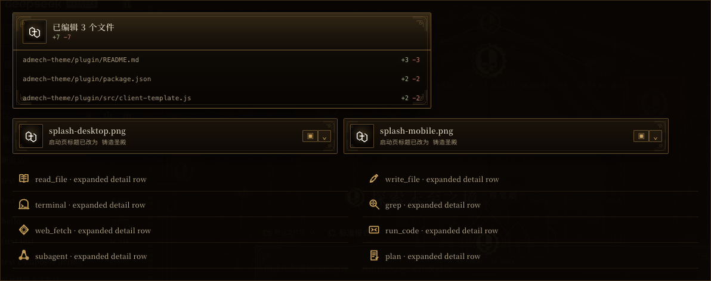

### 文件卡 / 已编辑文件框

- 已编辑文件卡（data-changed-files）：黄铜遗物框、双线内框、四角花窗、标题衬线化、文件路径等宽字体、diff 行使用暗橄榄绿 / 暗火星红；
- 交付文件卡（data-presented-file）：同样的遗物框语言，图标盒改为黄铜边框 + 暗色底，文件名衬线化，说明文字等宽化；
- 行悬停、展开按钮、操作按钮都加了黄铜 hover 与内阴影；
- 不修改组件 DOM，只做 CSS 覆盖；不引入新的 React 节点。

### 展开详细内容后的图标

上一版只替换了 process 组头部的 activity 图标。展开 process 组后，内部 ToolRow 仍显示 DSH 原生工具图标，因此出现“展开后原型鄙陋”的问题。v0.6.0 追加：

- 按 ToolRow 的 data-tool / data-variant 映射到同一套 Forge-Cathedral 图标：
  - read_file → process_read
  - write_file → process_edit
  - terminal / bash → terminal
  - grep / search → search
  - web_fetch → process_web
  - run_code / code → process_code
  - subagent → trinity
  - plan → process_plan
- 对未知工具名增加前缀/关键字 fallback，避免展开后掉回原生图标；
- 仍然使用 CSS mask，SVG 原生树不替换，composer 崩溃修复保持。

验证：

- 8 种展开详情 ToolRow 全部命中对应图标；
- 文件卡合成 DOM 渲染检查通过；
- 真实发送消息后 composer 仍存在（cardCount=1 / inputCount=1），控制台 0 errors；
- layout_audit PASS：1440×900 + 390×844，报告 .layout-guard/runs/20261018-195243-qhye-audit/report.json。


## v0.6.1：文件卡图标空白修复 + 展开“思考”图标

### 文件卡图标空白

v0.6.0 给文件卡图标的 SVG 加了较强的 sepia / brightness filter，把 FileTypeIcon 自身的白色底板和彩色字形一起洗白，最终出现“白色空方块”。

v0.6.1 移除这组洗白滤镜，只保留轻微阴影；图标盒仍保留黄铜边框与暗色衬底。文件类型图标恢复原本的颜色与字形。

### 展开后的“思考”图标

展开 process 组后，ReasoningRow 使用的是 DSH 原生 IconThinkOutlineRegular（原子/轨道图标），不属于 ToolRow，所以上次映射没有覆盖到。

v0.6.1 增加：

- 对 [data-variant="think"] 的 ReasoningRow，把 leading SVG 映射为 process_think（机魂之眼）；
- 思考行的标题/摘要同步使用衬线字体；
- ToolRow 与 process 组头部图标映射保持不变。

验证：

- 文件卡合成 DOM：FileTypeIcon 字形可见，不再空白；
- 展开思考行：data-admech-icon=process_think；
- 控制台 0 errors；
- layout_audit PASS：1440×900 + 390×844；
- 报告：.layout-guard/runs/20261018-195612-x4mu-audit/report.json。


## v0.6.2：账户 / 查询用量 / 充值 的兼容性排查

隔离环境检查结果：

- 账号菜单可以正常打开；
- 菜单项的 pointer-events 是 auto，没有被主题装饰层遮挡；
- 点击“登录”时菜单项 click 事件正常触发（defaultPrevented=false），控制台无错误；
- 查询用量 / 充值在 Desktop 上通过 nativePlatform 打开 DSH 的 WebContentsView（DSH 宿主页面），不在主题 DOM/CSS 的范围内，主题无法拦截该页面的按钮。

v0.6.2 增加的防御性处理：

- 启动动画遇到 account / platform / billing / top-up / usage 等路径时直接跳过；
- 点击账号菜单中的用量、充值等操作时，如果启动动画仍存在，立即将其移除；
- 对菜单、对话框、账号区域的 a/button 显式设置 pointer-events: auto 与 z-index，避免装饰层继承/覆盖点击区域。

如果你的环境里仍打不开，请提供“点击后具体表现”（无反应 / 空白原生页 / 报错）以及 DevTools Console 错误；这通常需要区分是账号状态 links 缺失、WebContentsView 宿主问题，还是 DSH 版本问题。


## v0.6.3：修复查询用量 / 充值原生页加载失败

### 根因

DSH Desktop 的“查询用量 / 充值”会挂载一个原生 Platform WebContentsView。它的宿主 DOM 是一个：

    <div role="dialog" aria-modal="true">
      <header data-window-drag="true">…返回 DeepSeek Harness…</header>
      <div class="…viewport">…</div>
    </div>

主题的通用 role=dialog 哥特框样式把它也当成了普通对话框，覆盖了它的：

    position: fixed; inset: 0; overflow: visible; border; background; …

导致 PlatformOverlay 的 .viewport 尺寸/位置错误，bridge.open(page, bounds) 拿不到有效 bounds，加载失败，只显示“操作未完成，请重试 / 返回 DeepSeek Harness”。

### 修复

- 用 role=dialog:has(> header [data-window-drag]) 识别原生 Platform 宿主；
- JS 同时打上 data-admech-platform-overlay="true" 作为兼容标记；
- 对这两种选择器强制恢复：

    position: fixed;
    inset: 0;
    z-index: 1001;
    display: flex;
    flex-direction: column;
    background: var(--dsw-alias-bg-base);
    background-image: none;
    border: 0;
    border-radius: 0;
    box-shadow: none;

- 隐藏主题的 ::before / ::after（内框与徽章），不再影响原生页 bounds。

#

## v0.7.12：机械神甫 SVG 素材 · 外轮廓 + 原始权杖左侧轮廓

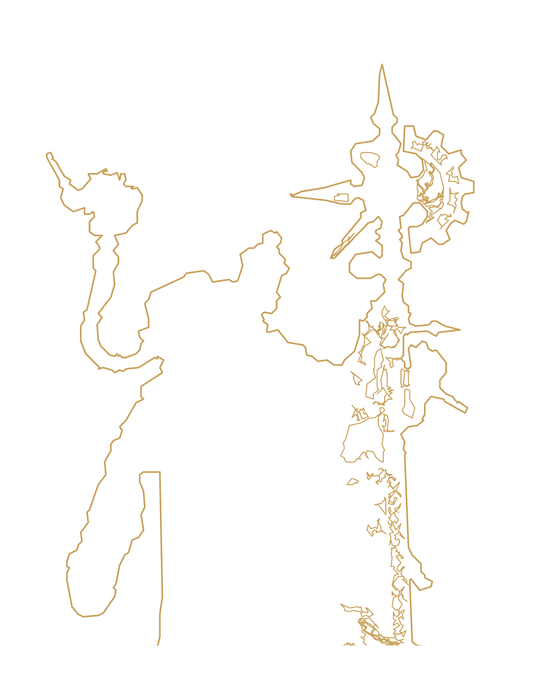

- 最终结果**只包含金色线条**：所有元素 fill="none"，无照片填色、无白色/灰色块、无剪影填充、无红色；
- 按参考轮廓做**金色线条描红**：外轮廓与主要结构轮廓均由金色线描出；
- 无位图内嵌；底部金色底盘/基座完全移除；
- 文件：assets/tech-priest.svg（约 39KB，381×470 viewBox，透明底，可无损放大）；
- 背景仍是原来的铸炉圣殿，**没有改动背景上的机械神甫**；
- 这是独立素材，可用于后续替换背景人物、做启动页/卡片插画或单独导出 PNG。

授权注意：该 SVG 是从你提供的参考照片做的同人矢量重建，参考照片的权利状态未验证；仅建议自用/非商业，不纳入 MIT 或 CC 授权。


## v0.7.13：背景图移除机械神甫

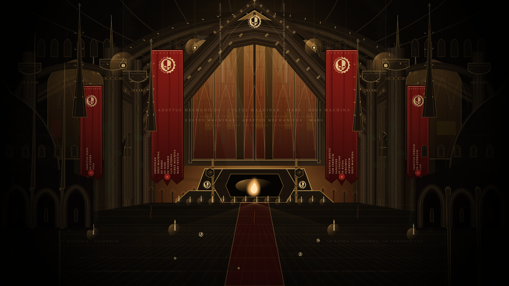

- 背景 SVG 中原有的 4 个机械神甫组已全部删除；
- 铸炉圣殿建筑、旗帜、文字、地砖与光效保持不变；
- 不再把独立的神甫素材放回背景；
- 客户端 bundle 已重新构建。

## 验证

合成 PlatformOverlay DOM 检查：

- position: fixed，inset: 0；
- 900px 高窗口下 viewport 为 1440×852（header 48px 之后）；
- border: 0，border-radius: 0，background-image: none；
- 主题伪元素 display: none；
- layout_audit PASS，报告 .layout-guard/runs/20261018-200526-gdvk-audit/report.json。

## 验证

- 隔离 DSH Home 的 **DSH 0.2.1-rc.2** profile 安装并启用；
- layout_audit **PASS**：1440×900 + 390×844，**0 errors**；
- 报告：.layout-guard/runs/20261018-200526-gdvk-audit/report.json；
- 控制台无插件报错；
- 图标替换：hero 页 24/33 个可见 SVG、插件页 28/35 个。
- **Windows 11 真机（v0.7.0）**：1440×900 @100%、1440×900 @125%、1920×1080 @150%、1280×800 @125%、Snap 1100×760 / 900×720、窄窗 760×640 共 9 个视口，均为 **文字裁切 0 / 交互元素重叠 0 / 控制台 0 报错**；另验收 Windows 标题栏条、高对比度主题、减少动态效果三条平台路径。详见文末「Windows 适配（v0.7.0 · 实测）」。

## 安装

1. 左侧栏 **插件** → **添加插件**（或箭头 → 安装第三方插件）
2. 路径：

    /Users/richard_dou/Desktop/插件工厂/admech-theme/plugin

3. 安装 → **立即启用**；提示重启就重启 DSH。

## 构建与源码

    src/icons.json            # 32 枚 UI 图标，emblem 使用你提供的图标
    src/styles.css            # token / 输入框 shrine / 会话框 crest / 图标
    src/client-template.js    # 主题、图标替换、徽记与装饰
    src/build-client.mjs      # 生成 lib/client.js
    assets/gear-skull-gold-*.png
    assets/forge-cathedral.svg / .png

    cd admech-theme/plugin
    node src/build-client.mjs
    node --check lib/client.js

## 边界

- 背景仍是矢量 SVG 插画，不是照片级 / 手绘原画；可以继续细化；
- 深色 only；设置页 / 仪式动画 / 音效未做；
- tool 卡 / 审批卡尚未逐组件精修；
- 桌面版尚未安装到你的日常 profile。

## IP

粉丝向原创演绎；背景为原创 SVG；齿轮-骷髅来自你提供的素材，仅按你的要求用于自用主题。


## 从 GitHub 安装（公开仓库）

仓库地址：

    https://github.com/RichardDou0607/dsh-theme-admech

### DSH Desktop

1. 左侧栏 **插件** → **添加插件**（或箭头 → 安装第三方插件）；
2. 输入 Git 地址：

       github:RichardDou0607/dsh-theme-admech

   或：

       https://github.com/RichardDou0607/dsh-theme-admech

3. 安装 → **立即启用**；提示重启就重启 DSH。

也可以直接下载仓库 ZIP，解压后以本地目录安装。

> **Windows 提示**：`github:` 规格依赖 Git 与可用代理，在「代理失效 / 证书链不全」的机器上会直接失败（实测见文末）。Windows 上推荐「下载 ZIP → 本地 `file:` 安装」，完全离线且不需要 Git。

### DSH Web / CLI

    dsh plugin --profile web add "github:RichardDou0607/dsh-theme-admech"

Windows 上若上面这条因为代理 / 证书失败，改用本地目录（实测可用）：

    dsh plugin --profile web add "file:C:\dsh-theme-admech\dsh-theme-admech-main"

## 许可 / IP（重要）

本仓库是**混合许可**，不是单一 OSI 开源许可：

- **代码**（src、lib、构建脚本、cordis.patch.yml）：MIT，见 LICENSE；
- **原创主题素材**（forge-cathedral.svg/png、手绘图标、输入/会话框 ornament、截图）：CC BY-NC-SA 4.0，仅限非商业使用，需署名并以相同方式共享；
- **你提供的齿轮-骷髅徽记**：由仓库所有者提供，未纳入 MIT / CC 授权，权利状态请见 ASSETS-LICENSE.md；
- **非官方粉丝作品**：与 Games Workshop 无关联，不含官方 logo / 官方插画；详见 DISCLAIMER.md；
- **非商业使用不等于没有版权/商标风险**。公开分发前请确认素材授权；商业使用前建议替换掉一切 GW 风格名称/符号，并咨询知识产权律师。


## Windows 适配（v0.7.0 · 实测）

> 实测环境：Windows 11（10.0.26300，中文系统，代码页 936）· DSH Desktop Web（运行时 0.2.1-rc.2，Electron 44.7.0）· Chromium 154 · 同一台机器的 100% / 125% / 150% 三档缩放。渲染与度量通过 `tools/win-audit/` 里的 CDP 审计脚本完成（见文末「Windows 渲染审计」）。

v0.4.1 只加了字体回退，**没有在 Windows 真机上跑过**。v0.7.0 补上了真机验收，并修掉了下面这些只有 Windows 才会暴露的问题。

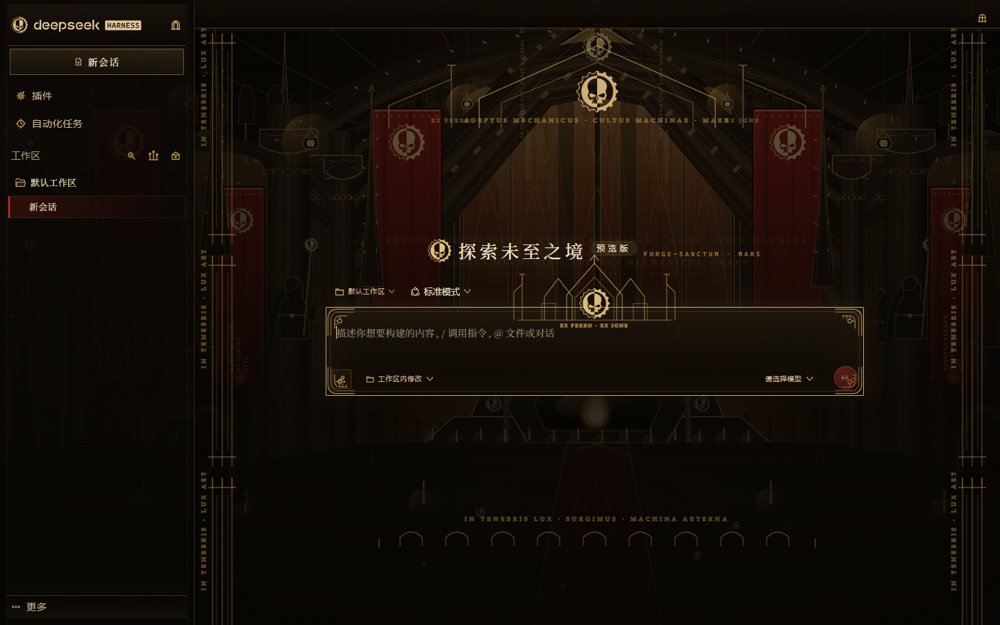

_Windows 11 · 1440×900 · 100% 缩放。_

### 1. Windows 窗口顶部的原生标题栏条

Windows 版 DSH 用 `titleBarStyle: "hidden"` + `titleBarOverlay`，宿主会在 `html` 上打 `data-windows-titlebar` 标记，并给整个 frame 加 `padding-top: var(--dsh-windows-titlebar-height)`（本机 40px）来给最小化/最大化/关闭让位。主题本身不碰这块，实测主题色（`--dsw-specific-sidebar-fill`）会自动铺满这条 40px 带，与侧边栏、会话区衔接正常，**无需额外处理**——但如果你换了 `--dsw-specific-sidebar-fill`，记得这条带是跟着它走的。

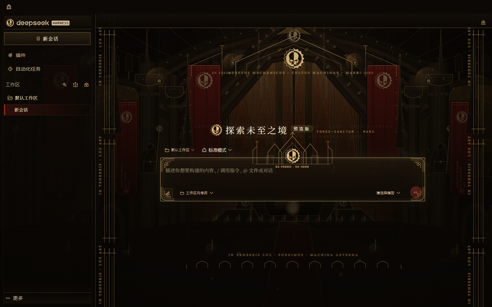

_Windows 桌面：顶部 40px 原生标题栏条（`data-windows-titlebar`）与侧边栏、会话区的衔接。_

### 2. 1px 花丝线在 125% / 150% 下发虚

Windows 最常见的缩放是 125%（笔记本）和 150%（1080p 屏）。1 CSS px 在这些缩放下落到 1.25 / 1.5 设备像素，Chromium 只能用抗锯齿去凑，结果就是铜色花丝比 macOS（2× 下 1px = 整整 2 设备像素）更暗、更糊。

- 新增 `--admech-hairline`：客户端半按 `devicePixelRatio` 计算，100% → `1px`，125% → `0.8px`，150% → `0.667px`（都正好 1 设备像素），200% 及以上回到 `1px`；
- 主题里 **45 处**装饰性边框 / 内嵌描边（`border*: 1px`、`inset 0 0 0 1px`、焦点环）全部改成 `var(--admech-hairline, 1px)`；
- 移动窗口到另一块缩放不同的显示器时，`resize` 会重新计算，不用重启。

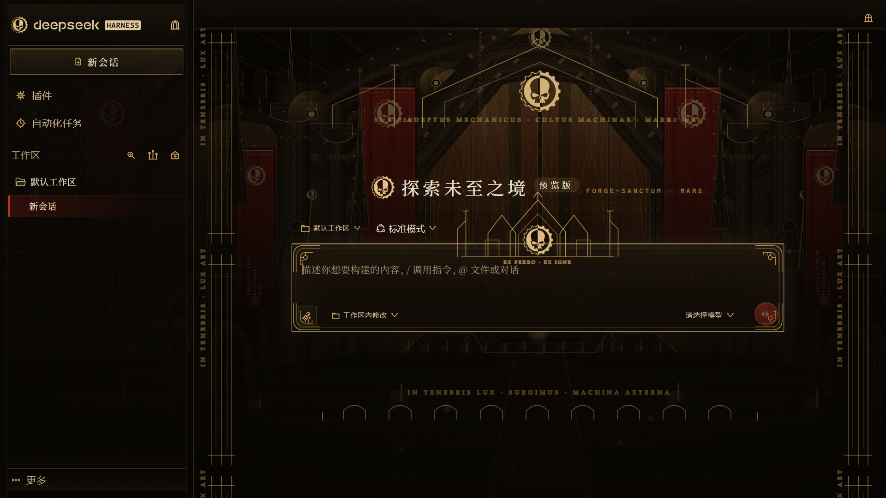

_1920×1080 · 150% 缩放（CSS 视口 1280×720）。_

实测：150% 下量同一列像素，边框亮带的过渡从「6 列渐变」收到「5 列、核心更亮」，视觉上是一条干净的线而不是一层雾。

### 3. 小尺寸花角（文件卡 26px / 交付卡 20px）几乎看不见

花角字形画在 48 单位的画布里，缩到 26px 时 `stroke-width: 1.15` 只剩 **0.62 CSS px**；macOS 2× 下还有 1.24 设备像素，Windows 100% 下只有 0.62 设备像素，等于一层鬼影。

- 新增密度校正的第二套花角 `--admech-corner-sm-*`，笔画按 `max(1.15, 1.7 / dpr)` 生成；
- 只给 26px / 20px 两处卡片框用，42px 输入框和 48px 对话框保持原笔画。

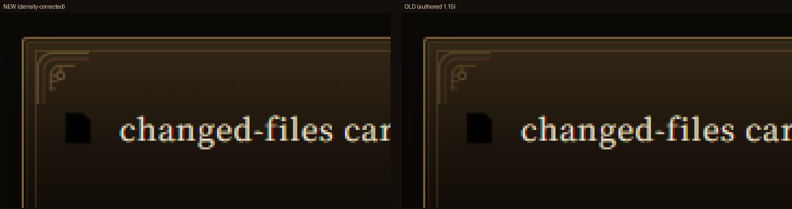

_左：v0.7.0（密度校正）；右：v0.6.3（原笔画）。同一页面、同一位置、4× 放大。_

### 4. 滚动条宽度与宿主布局几何对不上

宿主主题全局注入 `::-webkit-scrollbar { width: var(--dsh-scrollbar-width) }`（WebKit 下默认 5px，部分面板自行改成 8/9px），而输入框座（`composerSeat`）等布局是拿同一个变量算偏移的。主题原先硬写 `width: 8px`，在 Windows 上等于**每条滚动条都比宿主以为的宽 3px**，输入框右侧会顶出 3px。

- 改成 `width: var(--dsh-scrollbar-width, 8px)`，跟着宿主走；缩略图配色保留。

### 5. 只在 Windows 才付的合成成本

- **顶栏 `backdrop-filter: blur(7px)`**：顶栏自己铺的是 92–96% 不透明的渐变，模糊根本看不见，但 Windows 的 D3D 合成路径每一帧都要重采样下面的滚动内容。Windows 下直接关掉（macOS 保留）。
- **启动页退场 `transform: scale(1.012)`**：整屏缩放会强制重采样整张启动页位图（花窗、文字全部），125%/150% 下肉眼可见发软。Windows 下退场只用 opacity。

  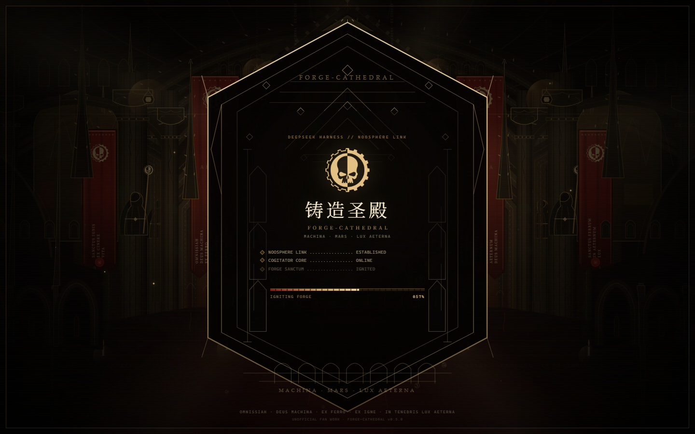
- **MutationObserver 每帧重扫全文档**：宿主在虚拟滚动时写内联 `transform`、流式输出时不停换节点，原实现每个动画帧都会把 `tagNodes()` + `replaceAllIcons()`（5 轮全文档 `querySelectorAll`）跑一遍。现在 120ms 节流、忽略 `style` 变更、启动页盖住界面时观察器完全待机，启动页移除后再补一次扫描。

### 6. Windows「动画效果：关闭」→ 启动页直接不出现

`prefers-reduced-motion: reduce` 之前只停掉动画，但点火页仍会整屏盖住 0.65–3.6 秒。现在减少动态效果时**根本不挂载启动页**，直接进界面。

### 7. Windows 高对比度主题（Contrast Themes）

高对比度会强制系统色用于文字和边框，但不会清掉主题的渐变背景、data-URI 纹章和 icon mask，结果是系统色文字压在黑色花窗上、图标变空白块。新增 `@media (forced-colors: active)` 块：去掉装饰层与阴影，还原原生图标，保留可读的边框。

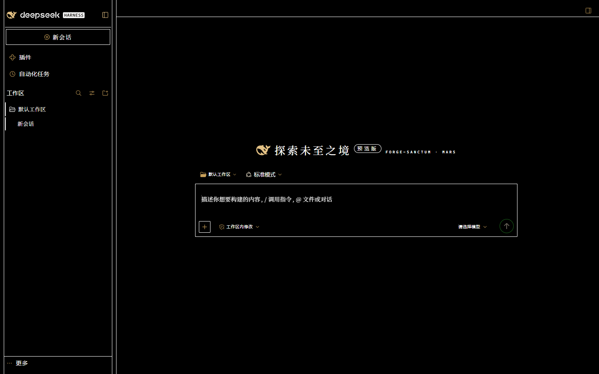

### 8. SVG 花纹文字落到 Times New Roman

花纹里的 9 处 `<text>` 写的是 `font-family='Palatino, serif'`。Windows 只装了 **Palatino Linotype**，没有 `Palatino`，也没有字体替换映射，于是全部退到 Times New Roman——"FORGE-CATHEDRAL"、"EX FERRO · EX IGNE"、"IN TENEBRIS..." 的字宽和字面都变了。已改成 `Palatino Linotype, Palatino, Georgia, serif`。

### 9. 其余小修

- **字体栈**：`--admech-serif` 现在的顺序是 `Noto Serif CJK SC → Noto Serif SC → Source Han Serif SC → Songti SC → Palatino Linotype → Palatino → Georgia → SimSun → NSimSun → 宋体 → 新宋体 → Microsoft YaHei → 微软雅黑 → serif`。中文 Windows 同时注册「SimSun」和「宋体」两个族名，两个都写上更稳；`--admech-mono` 补了 `Cascadia Code`。
- **启动页标题 `font-weight: 500`** 改成 `400`：两套字体栈里都没有 500 这个字面，写 500 只会让浏览器去合成。
- **标题旁的小标签（`FORGE-SANCTUM · MARS`）** 加 `white-space: nowrap`：它是宿主 `flex-wrap` 标题行的第三个 flex 项，Windows 的拉丁字体更宽，原先可能被折成两行。
- **启动页徽记** 改用 256px 源图（92px × 150% = 138 设备像素，原先的 128px 源会被放大）；24px 图标走 mask，继续用 64px 源，不增大包体。
- **短视口下的对话框徽章**：1080p × 150% 的 CSS 视口只有 720px 高，对话框按 24px 上边距居中时 84px 徽章会被裁掉 14px。`@media (max-height: 760px)` 缩到 64px。
- **停用插件后残留深色 `color-scheme`**：cleanup 现在会还原 `color-scheme` 并摘掉 `data-ds-dark-theme`，否则原生下拉、滚动条、表单控件会一直是深色。

### 实测结论

| 场景 | 结果 |
| --- | --- |
| 1440×900 @100% | 无文字裁切、无非预期遮挡，图标替换 25/30（其余是装饰性/非插件图标） |
| 1440×900 @125% / 1920×1080 @150% | 同上；花丝线为整设备像素 |
| Windows Snap 半屏 1100×760、三分之一 900×720、窄窗 760×640 | 无裁切、无重叠；≤900px 时会话区花窗按设计隐藏 |
| Windows 桌面标题栏条（模拟 40px + `data-windows-titlebar`） | 顶部条与主题色衔接正常 |
| 高对比度（forced-colors） | 装饰层关闭、原生图标恢复、文字可读 |
| 减少动态效果 | 启动页不出现，直接进界面 |

**已知差异 / 未覆盖**：

- 如果你的 Windows 没装任何衬线中文字体（英文版 Windows 未装「简体中文补充字体」，也没有 Noto Serif SC），中文会落到 **Microsoft YaHei（黑体）**，拉丁文仍是 Palatino Linotype——这是字体可用性问题，不是布局问题；装上 `宋体`/`SimSun` 或 Noto Serif SC 即回到设计意图。
- 文字用的是宿主字号，7–9px 的装饰性拉丁小字在 100% 下比 macOS 2× 稍粗，这是 ClearType 与灰度抗锯齿的差别。
- 本次验收用的是同一台机器的无头 Chromium + 模拟 `data-windows-titlebar`，**没有直接截取 Electron 原生标题栏**（最小化/最大化/关闭由系统绘制，位于网页图层之上）；标题栏按钮颜色由宿主的 `titleBarOverlay` 从 `--dsw-specific-sidebar-fill` / `--dsw-alias-label-primary` 同步，主题只负责这两个 token。
- macOS 行为保持不变：所有平台专属规则都挂在 `[data-admech-os="win"]` 或 `@media (forced-colors: active)` / `(max-height: 760px)` 下。

### Windows 安装（实测）

> 以下步骤在全新 `DSH_HOME` 上逐条验证通过。`dsh` 命令位于安装目录 `resources\runtime\cli\bin\dsh.cmd`，建议加入 PATH 或用完整路径。

**推荐：下载 zip → 本地安装（不需要 git，不需要访问 pnpm registry）**

```powershell
Invoke-WebRequest -Uri 'https://github.com/RichardDou0607/dsh-theme-admech/archive/refs/heads/main.zip' `
  -OutFile "$env:TEMP\dsh-theme-admech-main.zip"
Expand-Archive -LiteralPath "$env:TEMP\dsh-theme-admech-main.zip" -DestinationPath 'C:\dsh-theme-admech' -Force

dsh --profile admech --from-default-profile web --dump-config
dsh plugin --profile admech add 'file:C:\dsh-theme-admech\dsh-theme-admech-main'

dsh --profile admech --port 0 --no-open
```

打开打印出来的 `http://127.0.0.1:<端口>/?token=…` 即完成。确认 profile 里出现主题行：

```powershell
dsh --profile admech --dump-config
# - id: theme-admech
#   name: dsh-theme-admech
```

**中文路径可用（实测）。** 插件放在 `D:\桌面\插件工厂\repo` 这类路径，安装后记录为 `"file:D:/桌面/插件工厂/repo"`（正确 UTF-8），启动与下发均正常。若在 GBK(936) 控制台直接 `Get-Content package.json` 看到 `妗岄潰/鎻掽欢宸ュ巶` 之类，那是**控制台显示**问题，不是写入错误——用 `-Encoding UTF8` 或编辑器复核。

**不要默认依赖 `dsh plugin add 'github:…'`。** 在「git 代理失效 / 证书链不全」的 Windows 机器上这条命令会直接失败（实测原文）：

```
[ERR_PNPM_GIT_RESOLVE_FAILED] Failed to resolve git dependency "github:RichardDou0607/dsh-theme-admech":
  git ls-remote failed: fatal: unable to access 'https://github.com/RichardDou0607/dsh-theme-admech.git/':
  Failed to connect to 127.0.0.1 port 7897 after 2079 ms: Couldn't connect to server
```

绕开代理后还可能遇到：

```
fatal: unable to access 'https://github.com/RichardDou0607/dsh-theme-admech.git/':
  SSL certificate problem: unable to get local issuer certificate
```

确实要用 git 规格时，可在同一条命令里临时绕过（不改全局配置，实测成功）：

```powershell
$env:no_proxy = '*'; $env:NO_PROXY = '*'
$env:GIT_CONFIG_COUNT = '1'; $env:GIT_CONFIG_KEY_0 = 'http.sslVerify'; $env:GIT_CONFIG_VALUE_0 = 'false'
dsh plugin --profile admech add 'github:RichardDou0607/dsh-theme-admech'
```

> `http.sslVerify=false` 会跳过 TLS 校验，仅建议在临时/受控环境使用；长期方案是修好代理与系统 CA，或直接用 zip 流程。

**`file:` 安装是硬链接。** 同一磁盘卷下，profile 里的 `node_modules\dsh-theme-admech` 与源目录是硬链接：重建源码会直接改到已安装文件，但 DSH 只在启动时读取客户端 bundle，**必须重启 profile 进程**才生效。想要独立快照，就把插件放到另一个盘再装。

## Windows 渲染审计（可复现）

仓库自带 `tools/win-audit/`，用无第三方依赖的 CDP 脚本驱动本机 Chrome，抓图并量化：

```powershell
# 1) 启动一个临时 profile（不影响日常 profile）
$env:DSH_HOME = 'D:\dsh-audit-home'
dsh --profile admech --from-default-profile web --dump-config
dsh plugin --profile admech add 'file:<插件目录>'
dsh --profile admech --port 54991 --no-open      # 记下打印出的 token URL

# 2) 抓图 + 度量（Node 22+，使用内置 WebSocket，无需 npm install）
node tools/win-audit/run-audit.mjs --url "http://127.0.0.1:54991/?token=..." --out shots/win --scenario desktop,desktop-125,win-1080p-150 --splash
node tools/win-audit/run-audit.mjs --url "..." --out shots/win --scenario desktop --desktop-win   # 模拟 Windows 标题栏条
node tools/win-audit/run-audit.mjs --url "..." --out shots/win --scenario desktop --media "forced-colors=active"
node tools/win-audit/run-audit.mjs --url "..." --out shots/win --scenario desktop --media "prefers-reduced-motion=reduce"
node tools/win-audit/run-audit.mjs --url "..." --out shots/win --scenario desktop --specimen     # 卡片花纹 A/B
```

每个场景输出 PNG + 同名 JSON，JSON 里包含：实际生效的字体栈、区域内字号/行高/字距、文字裁切检测（`scrollWidth/Height` 溢出）、交互元素重叠检测、滚动容器宽度、固定装饰层坐标、`data-admech-os` / `--admech-hairline` / `--dsh-scrollbar-width` 的取值。